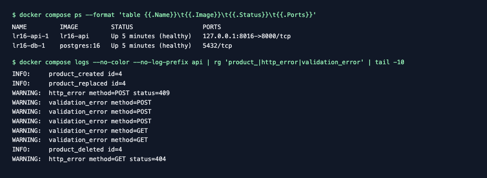
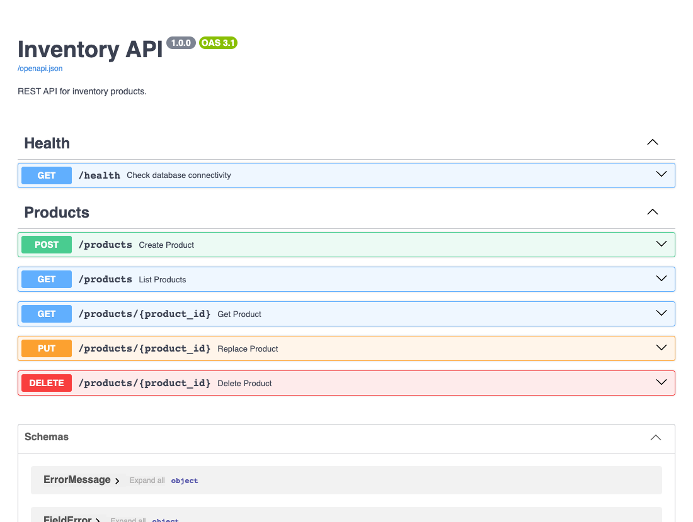
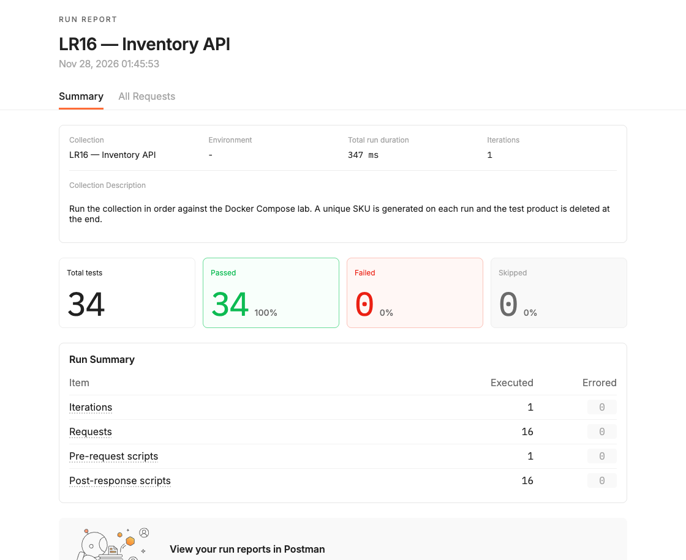
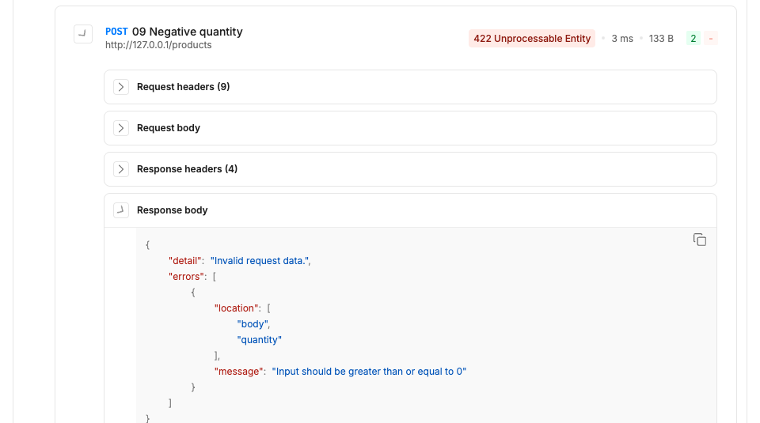

# Лабораторная работа № 16. REST-микросервис

**Цель** — реализовать микросервис, который взаимодействует по REST API. Сервис ведёт учёт складских позиций. Для каждой позиции PostgreSQL хранит артикул, название и количество.

## Развёртывание

```bash
git clone https://github.com/KirillFPV/LR16.git
cd LR16
docker compose up --build --wait
```

FastAPI доступен на `http://127.0.0.1:8016`. Swagger UI открывается по адресу [127.0.0.1:8016/docs](http://127.0.0.1:8016/docs), схема OpenAPI — по адресу [127.0.0.1:8016/openapi.json](http://127.0.0.1:8016/openapi.json). Для завершения работы выполните `docker compose down`.

В [Dockerfile](Dockerfile) стадия `builder` устанавливает зависимости в виртуальное окружение. Стадия `runtime` получает готовое окружение и исходный код.

```dockerfile
FROM python:3.12-slim-bookworm AS runtime
ENV PATH="/opt/venv/bin:$PATH" \
    PYTHONDONTWRITEBYTECODE=1 \
    PYTHONUNBUFFERED=1
WORKDIR /srv
COPY --from=builder /opt/venv /opt/venv
COPY app/ ./app/
USER 10001:10001
```

[Docker Compose](compose.yaml) запускает FastAPI после проверки готовности PostgreSQL. Именованный том сохраняет записи. Тестовая позиция осталась доступной после `docker compose down` и повторного запуска.



Оба контейнера имеют статус `healthy`. В журнале видны создание, обновление и удаление позиции, а также отклонённые запросы.

## REST API и Swagger

| Метод и путь | Действие | Успех |
|---|---|---|
| `POST /products` | Создать позицию | `201 Created` и заголовок `Location` |
| `GET /products` | Получить список с `limit` и `offset` | `200 OK` |
| `GET /products/{product_id}` | Получить позицию | `200 OK` |
| `PUT /products/{product_id}` | Заменить артикул, название и количество | `200 OK` |
| `DELETE /products/{product_id}` | Удалить позицию | `204 No Content` |
| `GET /health` | Проверить соединение с PostgreSQL | `200 OK` |



Модель [Pydantic](app/schema.py) проверяет формат артикула, название и целочисленное количество. PostgreSQL проверяет уникальность артикула. Конфликт возвращается клиенту как `409`. [Код обработчика](app/main.py)

```python
    except UniqueViolation as exc:
        raise HTTPException(409, "SKU already exists.") from exc
    log.info("product_created id=%d", product["id"])
    response.headers["Location"] = f"/products/{product['id']}"
    return product
```

## Защита от SQL-инъекций

Все SQL-запросы используют фиксированный текст. API передаёт артикул, название, количество, идентификатор и параметры пагинации отдельными аргументами `execute()`. Psycopg отправляет текст запроса и его параметры в PostgreSQL отдельно. [Код запроса](app/main.py#L118) · [Документация Psycopg](https://www.psycopg.org/psycopg3/docs/basic/params.html)

```python
product = conn.execute(
    """INSERT INTO products (sku, name, quantity)
       VALUES (%s, %s, %s) RETURNING id, sku, name, quantity""",
    (data.sku, data.name, data.quantity),
).fetchone()
```

Коллекция Postman проверяет, что при создании, обновлении и повторном чтении позиции название с апострофом и точкой с запятой сохраняется полностью.

## Проверка в Postman

Импортируйте [коллекцию](postman/Inventory.postman_collection.json) в Postman и запустите её целиком. Для проверки из терминала используйте Postman CLI.

```bash
postman collection run postman/Inventory.postman_collection.json --no-report-events -r cli
```



Прошли **34 проверки в 16 запросах**. Повторный артикул вызвал `409`, чтение удалённой позиции — `404`, неверные данные и повреждённый JSON — `422`.



В ответе указано поле `quantity` и его допустимое минимальное значение. После ошибочных запросов `GET /health` вернул `200`. При отдельной остановке PostgreSQL тот же запрос вернул `503` с сообщением `Database unavailable.`.
